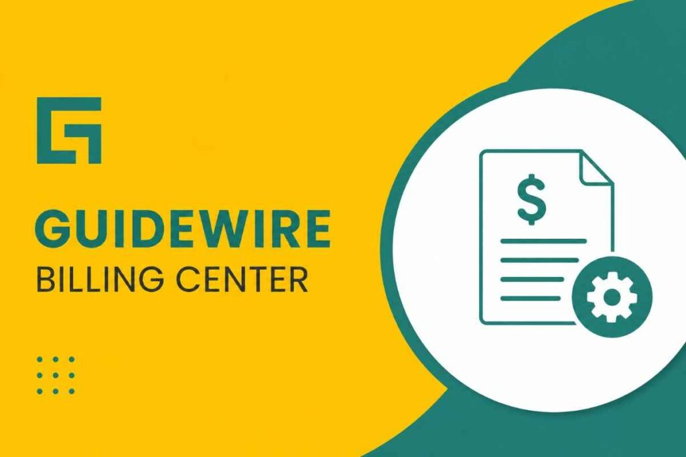

## 1\. Introduction to Guidewire Billing Center

The insurance industry is rapidly adopting digital billing platforms, and **Guidewire Billing Center** **Course** has become one of the most preferred solutions for modern insurers. Professionals looking to build a stable IT career are choosing **Guidewire Billing Center Training** to gain practical skills in billing operations, payment processing, and policy invoicing. With increasing demand for cloud-based insurance platforms, enrolling in a **Guidewire Billing Center Online Course** helps learners understand real-time business workflows and integration concepts. Many companies now prefer certified experts with hands-on knowledge, making **Guidewire Billing Center Certification** highly valuable in today’s competitive job market. Beginners can easily start learning the platform through structured modules, live projects, and industry-focused sessions that explain the complete billing lifecycle. Learning this technology opens doors to excellent career opportunities in insurance IT services and enterprise software consulting across global markets.

## 2\. What Is Guidewire Billing Center?

**Guidewire Billing Center** is a powerful billing management application designed specifically for the insurance industry. It enables insurers to automate billing cycles, handle customer payments, manage invoices, and streamline financial operations efficiently. Professionals enrolling in **Guidewire Billing Center Course** programs learn how the platform supports policy billing, payment plans, and account management. Companies actively seek candidates with **Guidewire Billing Center Training** because the demand for insurance technology specialists continues to rise globally. Through **Guidewire Billing Center Online Training**, learners gain practical exposure to billing workflows, data handling, and system integrations. Achieving **Guidewire Billing Center Certification** further strengthens professional credibility and improves job opportunities in insurance IT. 

::enroll-now

## 3\. Key Features of Guidewire Billing Center

One of the major reasons companies prefer **Guidewire Billing Center** is its advanced billing automation and flexible payment management capabilities. The platform supports invoice generation, payment tracking, delinquency processing, and commission handling for insurance providers. Through **Guidewire Billing Center Course**, professionals learn how to configure billing accounts, manage policy transactions, and automate financial workflows efficiently. Many learners join **Guidewire Billing Center Online Training** to gain real-time experience with payment processing and customer account management. Earning a **Guidewire Billing Center Certification** demonstrates expertise in handling insurance billing systems and improves career opportunities in the IT industry. Organizations rely on this platform because it reduces manual errors, improves billing accuracy, and enhances customer experience. 

## 4\. Benefits of Learning Guidewire Billing Center

Learning **Guidewire Billing Center** offers excellent career opportunities for professionals interested in insurance technology and enterprise applications. Insurance companies worldwide are adopting Guidewire solutions, creating strong demand for skilled experts with **Guidewire Billing Center Training**. Through structured **Guidewire Billing Center Course**, learners gain practical knowledge of billing operations, payment processing, and customer account management. Professionals who complete **Guidewire Billing Center Certification** programs often receive better job opportunities, higher salaries, and global career exposure. The platform teaches real-time insurance workflows that are highly valuable for developers, testers, analysts, and consultants. Companies prefer candidates with Guidewire expertise because they can efficiently handle billing systems and financial transactions. 

## 5\. Guidewire Billing Center Architecture Overview

Understanding the architecture of **Guidewire Billing Center** is essential for professionals working on insurance billing applications and enterprise implementations. The platform follows a robust multi-layered architecture that supports billing workflows, payment management, policy transactions, and account processing efficiently. Through **Guidewire Billing Center Course**, learners explore application layers, database structures, integration frameworks, and workflow configurations. Many students join **Guidewire Billing Center Online Training** programs to gain practical understanding of system components and real-time project architecture. Achieving **Guidewire Billing Center Certification** helps professionals demonstrate technical expertise in designing and supporting insurance billing environments. The architecture ensures scalability, security, and performance for insurance organizations handling large volumes of financial data. 

::whatsapp-us

## 6\. Core Components in Guidewire Billing Center

The success of **Guidewire Billing Center** **Course** depends on its powerful core components that support insurance billing and payment management operations. Important modules include account management, invoice processing, payment tracking, delinquency handling, and commission management. Through **Guidewire Billing Center Training**, learners understand how these components work together to automate financial workflows for insurance companies. Many professionals prefer **Guidewire Billing Center Online Training** because it provides practical exposure to real-time billing scenarios and system configurations. Completing **Guidewire Billing Center Certification** helps candidates prove their expertise in managing billing systems and customer account operations. These core components improve operational efficiency, reduce manual processing, and enhance customer satisfaction in insurance organizations. 

## 7\. Billing and Payment Processing in Guidewire Billing Center

Efficient billing and payment management are major strengths of **Guidewire Billing Center Course**, making it a preferred solution for insurance companies worldwide. The platform automates invoice generation, premium collection, payment distribution, and refund processing with high accuracy. Through **Guidewire Billing Center Training**, professionals learn how to manage billing cycles, payment plans, and account reconciliation processes effectively. Many learners choose **Guidewire Billing Center Online Training** to gain hands-on experience in real-time billing workflows and customer payment handling. Completing **Guidewire Billing Center Certification** increases professional credibility and creates better opportunities in insurance IT careers. The system also supports multiple payment methods, automated reminders, and financial reporting features that improve operational efficiency. Understanding billing and payment processing concepts helps professionals deliver reliable insurance solutions.

## 8\. Guidewire Billing Center Integration Concepts

Modern insurance systems require seamless integrations, and **Guidewire Billing Center** **Course** provides strong integration capabilities for enterprise applications. The platform connects with policy management systems, claim applications, payment gateways, and external financial services efficiently. Through **Guidewire Billing Center Training**, learners understand integration frameworks, APIs, web services, and messaging systems used in real-time implementations. Many professionals enroll in **Guidewire Billing Center Online Training** to gain practical knowledge of system communication and data exchange processes. Achieving **Guidewire Billing Center Certification** demonstrates expertise in handling integrations and enterprise-level insurance solutions. Proper integration improves data accuracy, business efficiency, and customer service across insurance operations. Understanding these concepts helps developers and consultants manage complex projects, troubleshoot integration issues, and support digital transformation .

::enroll-now

## 9\. Guidewire Billing Center Data Model Explained

The data model in **Guidewire Billing Center** **Course** plays a critical role in managing insurance billing information, customer accounts, and payment transactions efficiently. It stores policy billing details, invoice records, payment history, and financial data in a structured format for easy processing. Through **Guidewire Billing Center Training**, learners understand database entities, relationships, schema structures, and transaction management concepts. Many students join **Guidewire Billing Center Online Training** to gain practical exposure to data handling and system customization techniques. Earning **Guidewire Billing Center Certification** validates professional expertise in managing billing databases and insurance workflows effectively. A strong understanding of the data model helps developers optimize application performance, improve reporting accuracy, and support enterprise-level billing operations.

## 10\. Roles and Responsibilities of a Guidewire Billing Center Developer

A professional working with **Guidewire Billing Center**  is responsible for developing, configuring, customizing, and supporting billing applications for insurance organizations. Developers manage payment workflows, invoice processing, integration services, and system enhancements based on business requirements. Through **Guidewire Billing Center Training**, learners gain practical knowledge of coding standards, configuration tools, and billing system implementations. Many aspiring professionals prefer **Guidewire Billing Center Course** to build technical expertise and gain real-time project experience. Completing **Guidewire Billing Center Certification** increases career opportunities and demonstrates professional credibility in insurance IT. Developers also collaborate with testers, business analysts, and consultants to ensure smooth application performance and successful deployments. 

::whatsapp-us

## 11\. Guidewire Billing Center for Insurance Industry

The insurance sector relies heavily on **Guidewire Billing Center** to manage complex billing operations, customer accounts, and financial transactions efficiently. The platform simplifies premium collection, payment processing, invoice generation, and policy billing for insurance companies of all sizes. Through **Guidewire Billing Center Course**, professionals learn industry-standard billing workflows and real-time insurance business processes. Many candidates enroll in **Guidewire Billing Center Online Training** to gain hands-on experience in implementing enterprise billing solutions. Earning **Guidewire Billing Center Certification** helps professionals secure better opportunities in insurance technology careers and consulting roles. Insurance organizations benefit from improved operational efficiency, reduced manual effort, and enhanced customer satisfaction using Guidewire applications. Understanding how the platform supports the insurance industry helps learners build strong domain knowledge and prepares them for successful careers in modern insurance IT environments and enterprise system implementations.

## 12.Guidewire Billing Center Configuration Basics

Configuration is an important part of **Guidewire Billing Center** **Course** because it allows insurance companies to customize billing processes according to business requirements. Professionals learn how to configure accounts, payment plans, billing rules, workflows, and customer notifications efficiently. Through **Guidewire Billing Center Training**, learners gain practical exposure to system settings, configuration tools, and policy billing management concepts. Many students choose **Guidewire Billing Center Course** to understand real-time configuration scenarios and implementation practices. Completing **Guidewire Billing Center Certification** demonstrates technical expertise in configuring enterprise billing applications for insurance organizations. Proper configuration improves billing accuracy, workflow automation, and customer service efficiency across business operations.  

::enroll-now

## 13\. Real-Time Projects in Guidewire Billing Center

Working on real-time projects is one of the best ways to master **Guidewire Billing Center** and gain practical implementation experience. Real-world projects help learners understand billing workflows, payment processing, integrations, customer account management, and insurance business operations effectively. Through **Guidewire Billing Center Training**, professionals gain hands-on knowledge of enterprise project execution and system customization techniques. Many learners prefer **Guidewire Billing Center Online Training** because it includes practical assignments, case studies, and implementation scenarios. Achieving **Guidewire Billing Center Certification** further strengthens professional credibility and improves placement opportunities in insurance IT companies. Real-time projects also help candidates develop troubleshooting, communication, and problem-solving skills required in enterprise environments.

## 14\. Career Opportunities in Guidewire Billing Center

The demand for professionals skilled in **Guidewire Billing Center** is growing rapidly as insurance companies continue adopting digital billing platforms and automation technologies. Career opportunities are available for developers, testers, business analysts, consultants, and support engineers with strong Guidewire expertise. Through **Guidewire Billing Center Course**, learners build technical and functional knowledge required for enterprise insurance projects. Many professionals enroll in **Guidewire Billing Center Online Training** to gain practical exposure and improve job readiness for the competitive IT market. Completing **Guidewire Billing Center Certification** increases professional credibility and helps candidates secure higher-paying roles in global insurance organizations. Companies prefer skilled professionals who understand billing systems, integrations, and customer account management processes.

## 15\. Best Guidewire Billing Center Online Training and Certification

Choosing the right **Guidewire Billing Center Online Training** program is essential for building a successful career in insurance technology and enterprise applications. A quality training course provides practical knowledge of billing workflows, payment processing, integrations, and real-time project implementation concepts. Through professional **Guidewire Billing Center Course**, learners gain hands-on experience with configuration tools, billing operations, and customer account management systems. Completing **Guidewire Billing Center Certification** demonstrates technical expertise and improves opportunities for high-paying jobs in insurance IT companies. The best training programs include expert mentorship, real-time assignments, interview preparation, and placement support for career growth. Learning **Guidewire Billing Center Course** from experienced professionals helps beginners understand industry requirements and enterprise workflows effectively. Strong technical knowledge and certification can help professionals achieve long-term success in the rapidly growing insurance software industry.

::whatsapp-us

