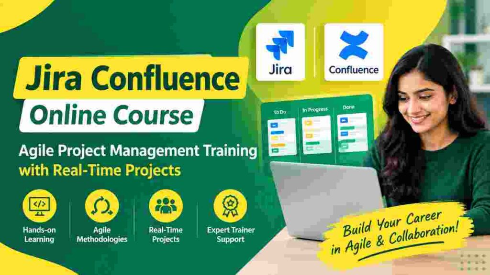

## 1.**What Is Jira Confluence Online Course and How Does It Work?**

A [**Jira Confluence Online Course**](https://ask4trainings.com/jira-confluence-online-training/) provides practical knowledge of Jira and Confluence for Agile project management, team collaboration, and project documentation. Through **Jira Confluence Online Training**, learners understand how to create projects, manage tasks, track issues, plan sprints, configure workflows, and monitor project progress using Jira. The course also introduces Confluence for creating, organizing, and sharing project documents, meeting notes, requirements, and knowledge bases. **Jira Confluence Training** helps learners understand how both platforms work together to improve communication and project visibility. With practical exercises and real-time project scenarios, learners can develop job-oriented skills for Agile and Scrum environments. This training can be useful for professionals, freshers, project teams, QA professionals, business analysts, and aspiring Jira administrators.

::enroll-now

## 2.Why Choose Jira Confluence Online Training for Agile Project Management?

Choosing a [**Jira Confluence Online Course**](https://ask4trainings.com/jira-confluence-online-training/) helps learners build practical skills in Agile project management, team collaboration, issue tracking, and project documentation. The course introduces Jira features used to manage tasks, sprints, workflows, backlogs, and project progress effectively. With **Jira Agile Training**, learners can understand Agile and Scrum practices and apply them to real-time project scenarios. **Jira Project Management Training** also helps professionals learn how to organize projects, track activities, create dashboards, and monitor team performance using Jira. Confluence skills support centralized documentation, knowledge sharing, and collaboration between teams. Practical exercises and real-time projects can help learners gain hands-on experience and improve their confidence. This training is useful for aspiring Jira professionals, project coordinators, Scrum teams, and IT professionals looking to strengthen their Agile project management skills.

## 3.What Will You Learn in Jira Confluence Online Training?

In our [**Jira Confluence Online Course**](https://ask4trainings.com/jira-confluence-online-training/), you will learn practical skills for managing Agile projects, tasks, workflows, and team collaboration. The **Jira Confluence Course** covers Jira project management, issue tracking, sprint planning, Scrum boards, dashboards, reports, and workflow management. You will also learn Confluence for creating project documentation, knowledge bases, team spaces, and collaborative content. The training includes practical exercises to help you understand how Jira and Confluence work together in real-time project environments. With **Jira Confluence Training in Hyderabad**, learners can develop job-oriented skills through hands-on practice and industry-based scenarios. You will gain an understanding of Agile and Scrum practices, Jira administration basics, Confluence documentation, project tracking, and collaboration tools. This practical learning approach helps you build confidence for Jira and Confluence-related roles.

::whatsapp-us

## 4.How Does Jira Support Agile and Scrum Project Management?

Jira is widely used by Agile teams to plan, track, and manage software projects efficiently. A [**Jira Confluence Online Course**](https://ask4trainings.com/jira-confluence-online-training/) helps learners understand how Jira supports Agile methodologies through practical project management activities. During **Jira Agile Training**, learners can work with backlogs, user stories, tasks, sprints, workflows, Scrum boards, and project dashboards. **Jira Scrum Training** focuses on sprint planning, backlog management, daily progress tracking, sprint reviews, and retrospectives. Jira also helps teams assign tasks, monitor project status, identify issues, and improve collaboration. By learning these features through real-time projects, professionals can develop practical Agile and Scrum project management skills. The training can help learners understand how Jira and Confluence work together for project documentation, communication, and team collaboration.

## 5.How Can Confluence Improve Team Collaboration and Documentation?

Confluence helps teams create, organize, and share important project information in one centralized workspace. Through a [**Jira Confluence Online Course**](https://ask4trainings.com/jira-confluence-online-training/), learners can understand how Confluence supports Agile teams and improves collaboration. **Confluence Collaboration Training** teaches professionals how to create team spaces, share project updates, manage meeting notes, and collaborate on documents efficiently. A **Confluence documentation course** helps learners develop practical skills for creating structured pages, maintaining knowledge bases, and managing project documentation. Confluence can also be integrated with Jira, allowing teams to connect tasks, issues, requirements, and project information. These capabilities improve communication, reduce information gaps, and make important documents easier to access. Learning Confluence through practical projects can help professionals build useful collaboration and documentation skills for modern Agile project environments.

::enroll-now

## 6.What Are the Key Features of Jira Project Management?

Jira provides powerful features for planning, tracking, and managing Agile projects. A [**Jira Confluence Online Course**](https://ask4trainings.com/jira-confluence-online-training/) helps learners understand how Jira can be used to organize tasks, create projects, manage issues, and monitor team progress. **Jira Project Management Training** covers important features such as Scrum and Kanban boards, sprint planning, workflows, dashboards, reports, issue tracking, task assignments, and project tracking. Learners can also understand how to create and manage user stories, bugs, epics, and project backlogs. **Jira Administration Training** introduces project configuration, user management, permissions, workflows, custom fields, notifications, and dashboard management. These features help teams improve collaboration, maintain project visibility, track deadlines, and manage Agile development activities efficiently in real-time project environments.

## 7.What Are the Important Confluence Features You Should Learn?

Confluence provides powerful features for team collaboration, documentation, and knowledge management. In a [**Jira Confluence Online Course**](https://ask4trainings.com/jira-confluence-online-training/), learners can understand how to create and organize pages, spaces, templates, and project documentation. A practical **Jira Confluence Course** also covers page editing, content sharing, comments, file attachments, permissions, and search features. Learners can understand how Confluence works with Jira to connect project tasks with documentation and improve team collaboration. The **Jira Confluence Training in Hyderabad** can help participants gain practical knowledge through real-time project scenarios. Important topics include creating team spaces, managing page hierarchies, using templates, tracking content updates, and collaborating with Agile teams. These skills are useful for professionals working in project management, software development, business analysis, and Agile environments.

::whatsapp-us

## 8.How to Manage Jira Issues, Tasks, Sprints and Workflows?

Managing Jira issues, tasks, sprints, and workflows is an important part of effective Agile project management. In a [**Jira Confluence Online Course**](https://ask4trainings.com/jira-confluence-online-training/), learners understand how to create, assign, prioritize, and track Jira issues throughout the project lifecycle. The training covers different issue types, task management, sprint planning, backlog management, and progress tracking. Through **Jira Workflow Training**, learners can understand how to design and manage workflows that match real-world business processes. **Jira Issue Management Training** also helps participants learn how to monitor issue status, set priorities, manage assignments, and track project progress. Practical exercises and real-time project scenarios help learners develop hands-on skills for working with Jira and Confluence in Agile and Scrum teams.

## 9.How Does Jira Confluence Training Help with Real-Time Projects?

[**Jira Confluence Online Course**](https://ask4trainings.com/jira-confluence-online-training/) helps learners develop practical skills by working on project-based scenarios similar to real workplace environments. The training covers Jira project management, issue tracking, sprint planning, workflows, dashboards, and Agile practices. Through **Jira Real-Time Project Training**, learners can understand how teams create tasks, assign work, monitor progress, manage sprints, and track project activities efficiently. **Jira Confluence Practical Training** also helps learners use Confluence for creating project documentation, sharing knowledge, maintaining requirements, and improving team collaboration. By practicing these activities with real-time project examples, learners can gain confidence in handling Jira and Confluence tools. The course is useful for professionals and beginners who want to build practical Agile project management skills and prepare for Jira Confluence-related career opportunities.

## 10.What Jira Administration Skills Are Covered in the Course?

Jira administration skills are an important part of the **Jira Confluence Online Course**, helping learners understand how to manage Jira projects and support Agile teams effectively. In **Jira Administration Training**, you will learn user and group management, project configuration, permission schemes, issue types, workflows, screens, custom fields, notifications, and Jira security settings. The **Jira Administrator Course** also covers dashboards, project roles, workflow customization, issue management, and reporting features. Learners gain practical knowledge through real-time project scenarios and hands-on exercises. The course helps you understand how Jira administrators configure projects, manage access, maintain workflows, and support teams using Jira and Confluence. This practical approach can help professionals develop useful Jira administration skills for Agile project environments and Jira-related career opportunities.

::enroll-now

## 11.How to Create Jira Dashboards and Generate Project Reports?

A [**Jira Confluence Online Course**](https://ask4trainings.com/jira-confluence-online-training/) helps learners understand how to create useful dashboards and track project performance effectively. In **Jira Dashboard Training**, you can learn to configure dashboards, add gadgets, customize layouts, and display important project information in an easy-to-understand format. Learners can create dashboards for tracking issues, sprint progress, team activities, and project status. **Jira Project Reports** help teams analyze project performance using reports such as sprint reports, velocity charts, burndown charts, and issue reports. Through practical exercises, learners can understand how to monitor project progress, identify pending tasks, and share project insights with stakeholders. This knowledge is valuable for Agile teams, project managers, Jira administrators, and professionals looking to build practical Jira skills through real-time project scenarios.

## 12.How Can Jira and Confluence Be Used Together in Agile Teams?

Jira and Confluence work together to help Agile teams manage projects, tasks, documentation, and team collaboration efficiently. Through a [**Jira Confluence Online Course**](https://ask4trainings.com/jira-confluence-online-training/), learners can understand how Jira supports sprint planning, issue tracking, task management, workflows, and project reporting. **Jira Online Training** helps professionals learn how to create and manage projects, boards, backlogs, and Agile workflows. At the same time, **Confluence Online Training** focuses on creating project documentation, meeting notes, requirements, knowledge bases, and team resources. Teams can connect Jira issues with Confluence pages, making project information easier to access and maintain. This integrated approach improves communication, supports Agile and Scrum practices, and helps teams organize real-time project activities effectively.

::whatsapp-us

## 13.Who Can Join Jira Confluence Online Training?

[**Jira Confluence Online Course**](https://ask4trainings.com/jira-confluence-online-training/) is suitable for freshers, IT professionals, project coordinators, software developers, testers, business analysts, and professionals working with Agile teams. Beginners who want to understand Jira and Confluence from the basics can join the **Jira Confluence Training for Beginners** and develop practical project management skills. Professionals looking to improve their Agile, Scrum, task management, documentation, and team collaboration skills can also benefit from this training. The **Jira Confluence Certification Course** can help learners build structured knowledge and strengthen their professional profile. This course is also useful for Scrum Masters, project managers, QA professionals, and aspiring Jira administrators who want hands-on experience with real-time project scenarios. No advanced technical background is required to start learning Jira and Confluence.

## 14.What Career Opportunities Are Available After Jira Confluence Training?

Completing a [**Jira Confluence Online Course**](https://ask4trainings.com/jira-confluence-online-training/) can help learners develop practical skills for Agile project management, issue tracking, team collaboration, documentation, and workflow management. After training, candidates can explore roles such as **Jira Administrator, Jira Project Coordinator, Agile Project Coordinator, Scrum Team Member, Confluence Administrator, and Project Management Support Specialist**. A **Jira Confluence Certification Training** program can help demonstrate knowledge of Jira workflows, dashboards, Scrum boards, Confluence spaces, and project documentation. Learners can also gain practical experience by working on real-time project scenarios. **Jira Confluence Placement Assistance Training** may provide career guidance, resume preparation, interview support, and job-search assistance. With hands-on knowledge of Jira and Confluence, professionals can apply these skills across Agile teams, software projects, IT organizations, and project management environments.

::enroll-now

## 15.How Can Jira Confluence Certification Support Your Career Growth?

A [**Jira Confluence Online Course**](https://ask4trainings.com/jira-confluence-online-training/) helps learners develop practical skills in Jira project management, Agile methodologies, Scrum, issue tracking, workflows, dashboards, and Confluence documentation. Through structured learning and hands-on practice, learners can understand how Jira and Confluence are used in real-world project environments. **Jira Confluence Placement Assistance Training** can provide additional career support through resume guidance, interview preparation, and job-oriented learning. A **Jira Confluence Career Training** program can help learners strengthen their knowledge of Agile project collaboration, task management, reporting, and team documentation. These skills can be useful for roles such as Jira Administrator, Project Coordinator, Agile Professional, and Confluence Administrator. With practical project exposure and certification support, learners can demonstrate relevant Jira and Confluence knowledge to potential employers.
