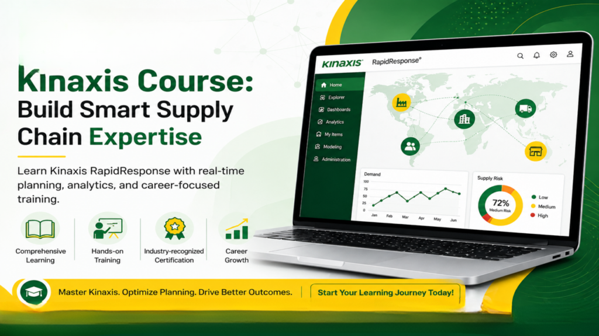

## 1.What is Kinaxis RapidResponse?

Kinaxis RapidResponse is a leading cloud-based solution used for modern supply chain planning and analytics. It enables organizations to manage demand planning, supply planning, and inventory optimization in real time. With its concurrent planning capability, businesses can analyze data across the entire supply chain and make faster, smarter decisions.This **Kinaxis RapidResponse overview** highlights how companies use the platform for scenario simulation, risk management, and improved operational efficiency. Through **Kinaxis Online Course India**, professionals can learn to work with real-time data, create dashboards, and optimize end-to-end supply chain processes. The **Kinaxis RapidResponse platform** is widely adopted across industries, making it a valuable skill for roles like supply chain analyst, planner, and consultant in today’s competitive job market.

## 2.Kinaxis Course Overview

**Kinaxis Online Course**  is designed to help professionals gain expertise in modern supply chain management using **Kinaxis RapidResponse**. This course covers demand planning, supply planning, inventory optimisation, and real-time analytics. Learners will understand how to manage end-to-end supply chain processes, perform scenario analysis, and build interactive dashboards. The training includes hands-on projects, case studies, and practical exercises aligned with industry requirements. Suitable for beginners and experienced professionals, this Kinaxis course enhances problem-solving and decision-making skills. With flexible online classes, expert trainers, and certification guidance, learners can confidently prepare for roles like supply chain analyst, planner, or consultant. Enroll in the **best Kinaxis RapidResponse Course** to boost your career with high-demand skills and global opportunities in supply chain management.

## 3\. Kinaxis Course Key Features

Master in-demand supply chain skills with **Kinaxis Online Course**  powered by Kinaxis RapidResponse. This course offers comprehensive coverage of demand planning, supply planning, and inventory optimization. Key features include hands-on real-time projects, industry-based case studies, and interactive dashboards for better data analysis. The **Kinaxis RapidResponse Online Course** provides expert-led sessions, flexible learning schedules, and access to recorded classes. Learners gain practical exposure to scenario simulation and end-to-end supply chain processes. This **Best Kinaxis Course** also includes certification guidance, resume building, and mock interviews to enhance job readiness. Suitable for beginners and professionals, the course ensures strong conceptual understanding and practical skills, making it the ideal choice for those seeking career growth in supply chain and analytics domains.

::enroll-now

## 4\. Kinaxis Benefits Explained

**Kinaxis Online Course India** helps professionals gain expertise in real-time supply chain management using Kinaxis RapidResponse. One of the key benefits is faster decision-making through real-time data visibility and analytics. The platform improves demand planning, supply planning, and inventory optimisation, reducing operational risks. With scenario simulation, businesses can quickly respond to disruptions and market changes. This **Kinaxis RapidResponse Online Course** enhances productivity by integrating end-to-end supply chain processes in a single platform. Learners benefit from hands-on projects, improving practical knowledge and job readiness. **Kinaxis Course with Placement Assistance** also supports career growth with high-demand skills, global opportunities, and attractive salaries, making it an ideal choice for professionals aiming to build a strong career in supply chain and analytics.

## 5\. Learn Kinaxis Requirement Management

**Kinaxis Online Course India** helps learners understand how to manage supply chain requirements using Kinaxis RapidResponse. This includes demand planning, supply planning, and inventory requirement management across the enterprise. The **Kinaxis RapidResponse Course** teaches how to analyze customer demand, align supply plans, and ensure optimal inventory levels. Learners gain hands-on experience in scenario simulation, enabling better decision-making and quick response to changes. This **Kinaxis Course Fees** in Hyderabad focuses on real-time data visibility, helping professionals track requirements efficiently and reduce risks. With expert guidance, practical projects, and certification support, this **Kinaxis Course for Beginners** builds strong skills for roles like supply chain analyst, planner, and consultant in global organizations.

::whatsapp-us

## 6\. Comprehensive Kinaxis Course

**Kinaxis Online Course India** offers a complete learning experience for mastering modern supply chain planning using Kinaxis RapidResponse. This **Kinaxis RapidResponse Online Course** covers demand planning, supply planning, inventory optimization, and real-time analytics. Learners gain hands-on experience through real-time projects, case studies, and interactive dashboards. The **Best Kinaxis Online Course** includes expert-led sessions, flexible schedules, and access to recorded classes for continuous learning. Participants also learn scenario simulation and end-to-end supply chain processes to improve decision-making skills. This **Kinaxis Certification Course** provides resume support, mock interviews, and placement assistance. Suitable for beginners and professionals, this course equips learners with industry-relevant skills, helping them secure high-paying roles such as supply chain analyst, Kinaxis consultant, and demand planner in top organizations.

## 7.Why Kinaxis Skills Are in High Demand

The demand for **Kinaxis RapidResponse** skills is rapidly increasing as companies prioritize real-time supply chain visibility and faster decision-making. With global disruptions and rising customer expectations, businesses need advanced tools for demand planning, supply planning, and inventory optimization. This is where **Kinaxis Online Course India** becomes highly valuable for professionals.Organizations prefer candidates with **Kinaxis RapidResponse skills** because the platform enables concurrent planning, scenario simulation, and data-driven insights. These capabilities help reduce risks, improve efficiency, and enhance operational performance. As more companies adopt digital supply chain solutions, the need for skilled Kinaxis experts continues to grow.By enrolling in the **Best Kinaxis Online Course** , professionals can gain in-demand skills, secure high-paying roles, and build a strong career in supply chain management and analytics across global industries.

## 8.Career Opportunities After Kinaxis Training

After completing **Kinaxis Online Course, the** professionals can explore a wide range of high-demand roles using Kinaxis RapidResponse. Career opportunities include Supply Chain Analyst, Kinaxis Consultant, Demand Planner, Supply Planner, and Business Analyst (SCM). These roles focus on demand planning, supply planning, inventory optimisation, and real-time analytics. With strong candidates, **Kinaxis Course Institute Ameerpet** can work with global organisations across the manufacturing, retail, and logistics industries. The **Best Kinaxis Course** also prepares learners for scenario simulation, data modelling, and decision-making processes, making them valuable assets to companies.Additionally, certification and hands-on project experience improve job prospects and salary potential. As demand continues to grow, K**inaxis Training Institute Ameerpet** offer excellent growth, stability, and international opportunities for both freshers and experienced professionals.

::enroll-now

## 9.Challenges in Learning Kinaxis

Learning Kinaxis RapidResponse can be rewarding, but beginners may face challenges while enrolling in the **Kinaxis Online Course India**. One common difficulty is understanding complex supply chain concepts like demand planning, supply planning, and inventory optimisation. Without prior domain knowledge, learners may take time to grasp these topics.Another challenge is mastering the platform’s real-time data analysis and concurrent planning features. The **Kinaxis RapidResponse Course** involves scenario simulation and dashboard creation, which require consistent practice. Technical learners may adapt quickly, but non-IT backgrounds might need extra effort. Additionally, hands-on experience is essential, and limited practical exposure can slow learning. However, choosing the **Kinaxis Functional Course Online** with real-time projects, expert guidance, and structured modules can help overcome these challenges and build strong, job-ready skills.

## 10\. Kinaxis Career Opportunities Guide

**Kinaxis Online Course India** opens doors to high-demand roles in supply chain management using Kinaxis RapidResponse. Professionals with **Kinaxis RapidResponse skills** can pursue careers as Supply Chain Analyst, Kinaxis Consultant, Demand Planner, Supply Planner, and Business Analyst (SCM). These roles involve demand planning, supply planning, inventory optimisation, and real-time analytics to improve business efficiency.The **Best Kinaxis Course** equips learners with hands-on project experience, scenario simulation, and data modeling skills required by top companies. With global adoption of Kinaxis, professionals can explore opportunities in manufacturing, retail, and logistics sectors. Certification and practical knowledge enhance job prospects and salary potential.Overall, **Kinaxis careers** offer strong growth, international opportunities, and long-term stability in the evolving supply chain domain.

## 11\. Kinaxis Online Course Benefits

**Kinaxis Online Course India** offers a flexible and effective way to build expertise in supply chain management using Kinaxis RapidResponse. One of the key benefits is learning real-time demand planning, supply planning, and inventory optimization through hands-on projects. The **Kinaxis RapidResponse Online Course** provides access to expert trainers, live sessions, and recorded classes for continuous learning.Another advantage is gaining practical experience in scenario simulation and data analytics, which improves decision-making skills. The **Best Kinaxis Online Course** also includes certification guidance, resume building, and mock interviews to enhance job readiness. Learners can study from anywhere, making it ideal for working professionals and freshers.Overall, this course helps build in-demand skills, ensuring strong career growth, high-paying job opportunities, and global exposure in supply chain roles.

::whatsapp-us

## 12\. Kinaxis Job-Oriented Course

**Kinaxis Online Course**  is designed as a job-oriented program to help learners build practical skills using Kinaxis RapidResponse. This **Kinaxis RapidResponse Course** focuses on demand planning, supply planning, inventory optimisation, and real-time analytics aligned with industry requirements. Learners gain hands-on experience through real-time projects, case studies, and scenario simulation. **The Kinaxis Supply Chain Management Course** program includes expert-led sessions, flexible online classes, and access to recorded materials for continuous learning. It also provides resume preparation, mock interviews, and placement support to improve job readiness. This **Kinaxis Course for Beginners** is suitable for freshers and professionals looking to transition into supply chain roles. With high demand for the Kinaxis RapidResponse Planning Course**,** this course helps secure roles like supply chain analyst, planner, and consultant in top organisations.

## 13\. Conclusion

In conclusion, completing a Kinaxis course equips professionals with the skills needed to excel in modern supply chain management. By learning Kinaxis RapidResponse, demand planning, supply planning, and real-time analytics, learners gain a competitive edge in today’s fast-paced business environment. This training enhances decision-making, improves visibility, and supports efficient supply chain operations. Whether you aim to become a supply chain analyst, planner, or consultant, Kinaxis certification opens doors to new career opportunities. Staying updated with Kinaxis tools and best practices ensures long-term growth and success. Invest in continuous learning and practical application to maximize the benefits of Kinaxis training and achieve excellence in supply chain planning and management.
