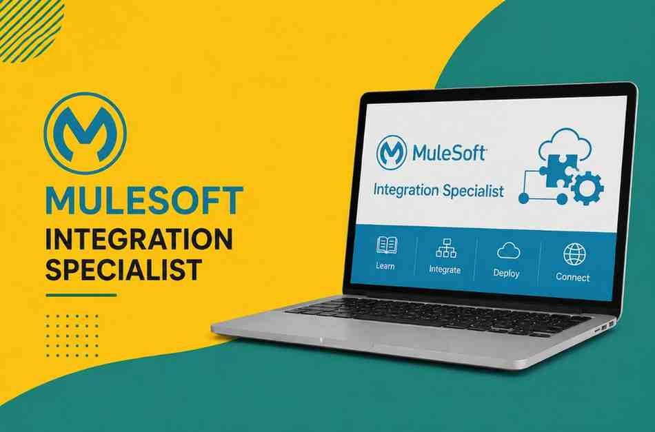

## 1.Introduction to MuleSoft

MuleSoft is a leading integration platform that enables organizations to connect applications, data, and devices through APIs. It helps businesses streamline processes, improve connectivity, and accelerate digital transformation initiatives. Our **MuleSoft online training** program is designed to provide comprehensive knowledge of API-led connectivity, integration architecture, and the Anypoint Platform. Through hands-on exercises and real-world projects, learners gain practical experience in building, managing, and securing APIs. Professionals looking for **MuleSoft training in Hyderabad** can benefit from expert-led sessions, industry-relevant curriculum, and certification guidance. This **MuleSoft course in Hyderabad** is suitable for beginners and experienced IT professionals who want to enhance their integration skills and build successful careers in enterprise application integration and API management.

## 2.Key Features of MuleSoft

MuleSoft offers a powerful integration platform that enables seamless connectivity between applications, systems, and data sources across an organization. One of its key features is API-led connectivity, which helps businesses build reusable and scalable integrations. Through our **MuleSoft online training**, learners gain hands-on experience with the Anypoint Platform, API design, development, management, monitoring, and security. MuleSoft also supports cloud, on-premises, and hybrid integrations, making it a versatile solution for modern enterprises. Professionals seeking **MuleSoft training in Hyderabad** can learn how to create efficient integration solutions using industry best practices. This **MuleSoft course in Hyderabad** covers real-time projects, practical assignments, and expert guidance, helping learners develop the skills required to manage enterprise integrations and drive digital transformation initiatives successfully.

::enroll-now

## 3.Why Choose MuleSoft?

MuleSoft is one of the most trusted integration platforms used by enterprises worldwide to connect applications, data, and services through APIs. Choosing MuleSoft enables organizations to simplify complex integrations, improve operational efficiency, and accelerate digital transformation. Our **MuleSoft online training** helps learners master API development, integration architecture, and the Anypoint Platform through practical, hands-on learning. With growing demand for integration professionals, acquiring MuleSoft skills can significantly enhance career opportunities in the IT industry. Professionals looking for **MuleSoft training in Hyderabad** benefit from expert-led sessions, real-time projects, and industry-focused learning. This **MuleSoft course in Hyderabad** is designed to equip learners with the technical expertise and practical experience needed to build scalable integration solutions and succeed in enterprise integration roles.

## 4.MuleSoft Training Benefits

Enrolling in a **MuleSoft Online Course** provides learners with the skills required to build, manage, and secure APIs using industry-leading integration technologies. Our **MuleSoft Online Training** program helps professionals understand API-led connectivity, cloud integration, data transformation, and enterprise application integration through practical exercises and real-time projects. Participants gain hands-on experience with the Anypoint Platform, enhancing their ability to solve complex business integration challenges. As the **Best MuleSoft Training in Hyderabad**, this course offers expert mentorship, certification guidance, and placement assistance to support career growth. By completing the training, learners can improve their job prospects, increase earning potential, and qualify for high-demand MuleSoft developer and integration specialist roles across various industries.

## 5.MuleSoft Career Opportunities

The demand for MuleSoft professionals continues to grow as organizations adopt API-led connectivity and digital transformation strategies. A **MuleSoft Online Course** equips learners with the technical expertise needed to design, develop, and manage enterprise integrations across cloud and on-premise environments. Through comprehensive **MuleSoft Online Training**, students gain practical experience with APIs, Anypoint Platform, data integration, and real-time project implementation. Recognized as the **Best MuleSoft Training in Hyderabad**, this program prepares candidates for rewarding roles such as MuleSoft Developer, Integration Engineer, API Developer, Middleware Consultant, and Solution Architect. With strong industry demand, certified MuleSoft professionals can explore excellent career opportunities, competitive salaries, and long-term growth prospects in leading IT companies and global enterprises.

::whatsapp-us

## 6.MuleSoft Certification Guide

Earning a MuleSoft certification is a valuable step toward validating your integration and API development skills. Our **MuleSoft Online Course** is designed to help learners understand certification objectives, exam patterns, and key concepts required for success. Through expert-led **MuleSoft Online Training**, participants gain hands-on experience with Anypoint Platform, API design, data transformation, and application integration. Recognized as the **Best MuleSoft Training in Hyderabad**, this program includes comprehensive study materials, practice exercises, mock tests, and real-time projects to strengthen technical knowledge. Learners receive guidance from experienced trainers to prepare confidently for MuleSoft certification exams. Achieving certification enhances professional credibility, improves career prospects, and opens doors to exciting opportunities in enterprise integration and digital transformation projects.

## 7.MuleSoft Developer Roadmap

A successful MuleSoft developer journey begins with understanding integration fundamentals, APIs, and cloud technologies. Our **MuleSoft Online Course** provides a structured learning path that guides students from basic concepts to advanced enterprise integration techniques. Through comprehensive **MuleSoft Online Training**, learners gain expertise in Anypoint Platform, API development, DataWeave, Mule applications, and deployment strategies. Recognized as the **Best MuleSoft Training in Hyderabad**, this program includes hands-on labs, real-time projects, and practical assignments to build industry-ready skills. Students also receive certification guidance, interview preparation, and career support throughout their learning journey. By following this roadmap, aspiring professionals can confidently progress from beginner to skilled MuleSoft Developer and secure opportunities in leading organizations worldwide.

::enroll-now

## 8.MuleSoft Integration Skills

Developing strong integration skills is essential for building connected and scalable enterprise applications. Our **MuleSoft Online Course** helps learners master key integration concepts, including API-led connectivity, data transformation, system integration, and cloud application connectivity. Through practical **MuleSoft Online Training**, participants gain hands-on experience with Anypoint Platform, Mule flows, DataWeave, REST APIs, and integration best practices. Recognized as the **Best MuleSoft Training in Hyderabad**, this program focuses on real-world implementation through projects, case studies, and expert guidance. Students learn how to integrate diverse systems, automate business processes, and manage APIs efficiently. These valuable MuleSoft integration skills enhance career opportunities and prepare professionals to handle complex enterprise integration challenges across various industries and business environments.

## 9.Real-Time Project Training

Our **MuleSoft Online Course** emphasizes practical learning through real-time projects that simulate actual business integration scenarios. Students gain hands-on experience in API development, cloud integration, data transformation, and enterprise application connectivity using the Anypoint Platform. Through expert-led **MuleSoft Online Training**, learners work on industry-relevant use cases that help them understand the complete project lifecycle, from requirement analysis to deployment and monitoring. Recognized as the **Best MuleSoft Training in Hyderabad**, this program enables participants to apply theoretical concepts in real-world environments and build a strong professional portfolio. Real-time project exposure enhances problem-solving abilities, technical expertise, and confidence, preparing learners for MuleSoft developer roles and helping them meet the expectations of top employers.

## 10.Job Roles in MuleSoft

The growing adoption of integration technologies has created numerous career opportunities for skilled MuleSoft professionals. Our **MuleSoft Online Course** prepares learners for various job roles by providing in-depth knowledge of API development, cloud integration, and enterprise connectivity. Through comprehensive **MuleSoft Online Training**, students gain practical experience with Anypoint Platform, DataWeave, and real-world integration projects. Recognized as the **Best MuleSoft Training in Hyderabad**, this program helps candidates qualify for positions such as MuleSoft Developer, Integration Engineer, API Developer, Middleware Consultant, Technical Lead, and Solution Architect. With industry-focused training, certification guidance, and hands-on project experience, learners develop the expertise required to excel in these high-demand roles and build successful careers in leading IT organizations worldwide.

::whatsapp-us

## 11.MuleSoft Placement Support

Our **MuleSoft Online Course** includes dedicated placement support to help learners transition successfully into the IT industry. Through comprehensive **MuleSoft Online Training**, students receive resume-building assistance, mock interviews, career counseling, and job referral support. Recognized as the **Best MuleSoft Training in Hyderabad**, our program focuses on developing both technical and professional skills required by employers. Participants work on real-time projects, gain hands-on experience with MuleSoft technologies, and receive guidance from industry experts. The placement support team helps learners prepare for interviews, improve communication skills, and connect with potential employers. This structured approach increases confidence and enhances opportunities for securing rewarding MuleSoft-related positions in leading organizations.

## 12.Advanced MuleSoft Concepts

The **MuleSoft Online Course** covers advanced concepts that enable professionals to build scalable and secure integration solutions. Through expert-led **MuleSoft Online Training**, learners explore advanced API management, DataWeave transformations, error handling, batch processing, security implementation, and performance optimization techniques. Known as the **Best MuleSoft Training in Hyderabad**, this program provides practical exposure through real-time projects and industry-focused assignments. Students gain a deeper understanding of enterprise integration patterns, cloud deployment strategies, and API governance. These advanced skills help professionals design efficient integration architectures and manage complex business requirements. Mastering advanced MuleSoft concepts enhances career growth and prepares learners for senior technical roles in enterprise integration environments.

::enroll-now

## 13.MuleSoft Industry Use Cases

Our **MuleSoft Online Course** introduces learners to real-world industry use cases that demonstrate the power of API-led connectivity and enterprise integration. Through practical **MuleSoft Online Training**, students learn how organizations integrate applications, automate workflows, connect cloud services, and manage data across multiple platforms. Recognized as the **Best MuleSoft Training in Hyderabad**, the course includes case studies from industries such as banking, healthcare, retail, manufacturing, and telecommunications. Learners gain hands-on experience solving business challenges using MuleSoft technologies and integration best practices. Understanding these industry use cases helps students apply their knowledge effectively and prepares them to contribute to digital transformation initiatives across diverse business sectors.

## 14.Best MuleSoft Learning Path

The **MuleSoft Online Course** offers a structured learning path designed to help beginners and professionals master integration technologies efficiently. Through comprehensive **MuleSoft Online Training**, learners start with API fundamentals, MuleSoft architecture, and Anypoint Platform before progressing to advanced integration techniques and real-time projects. Recognized as the **Best MuleSoft Training in Hyderabad**, this learning path combines theoretical knowledge with practical implementation to ensure complete skill development. Students receive certification guidance, project-based learning, and expert mentorship throughout the program. Following this well-defined learning path helps learners build confidence, develop industry-ready expertise, and achieve their career goals in MuleSoft development and enterprise integration.

## 15.Course Conclusion & Next Steps

The **MuleSoft Online Course** offers a structured learning path designed to help beginners and professionals master integration technologies efficiently. Through comprehensive **MuleSoft Online Training**, learners start with API fundamentals, MuleSoft architecture, and Anypoint Platform before progressing to advanced integration techniques and real-time projects. Recognized as the **Best MuleSoft Training in Hyderabad**, this learning path combines theoretical knowledge with practical implementation to ensure complete skill development. Students receive certification guidance, project-based learning, and expert mentorship throughout the program. Following this well-defined learning path helps learners build confidence, develop industry-ready expertise, and achieve their career goals in MuleSoft development and enterprise integration.

::whatsapp-us

